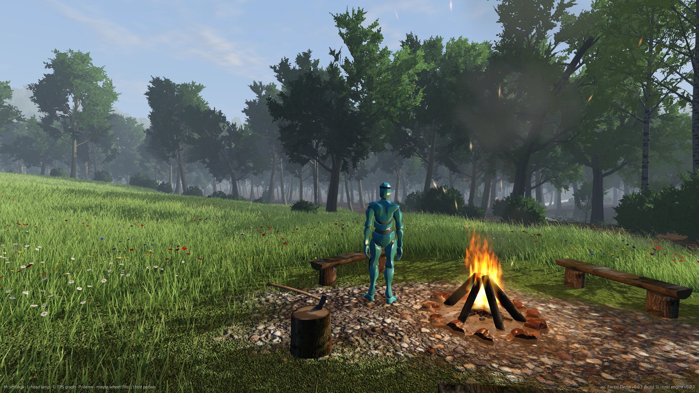
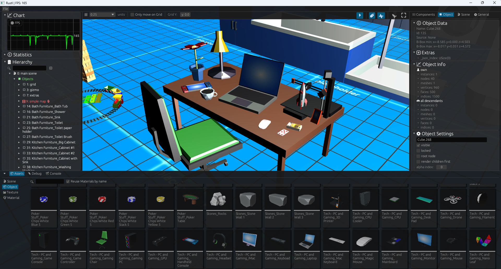

# Rustl - a game engine written in rust

* WIP (early but usable state) - but thigns will change!
* not production ready!
* Rustl is a game engine

## Screenshots of the current state

<br><br>


<br><br>

You can find more here: [History.md](History.md)

## Features

  * **Platforms**
    * Windows
    * Linux
    * Mac
    * Web (wasm)
  * **Rendering** (wgpu)
    * phong based (materials with textures, normal maps and transparency)
      * (PBR in the future)
    * custom material shaders (WGSL)
    * lights and cascaded shadows
    * SSAO
    * fog
    * object instancing
    * frustum and HZB occlusion culling
    * particles
  * **Animation**
    * skeletal animation
    * morph targets
    * animation blending
  * **Physics** (rapier)
    * rigid bodies
    * joints
    * contact events
  * **Controllers**
    * character controller
    * vehicles ctonroller
    * various camera controllers
  * **Audio** (rodio)
    * 3D spatial sound
  * **Input**
    * keyboard and mouse
    * touch
    * gamepads
  * **Assets**
    * glTF / glb import
    * OBJ import
    * JSON scene format
  * **Editor** (egui)
    * easy scene editing
    * per-project Rust code (dynamic and hot loaded)
    * export for all platforms

## Requirements

```bash
# install

# cargo watch
cargo install cargo-watch

# node.js (npm/npx) - runs scripts/build.mjs and npx serve, e.g. via nvm: https://github.com/nvm-sh/nvm
nvm install node

# web builds: wasm with threads needs nightly + build-std
rustup toolchain install nightly
rustup +nightly target add wasm32-unknown-unknown
rustup +nightly component add rust-src

# wasm-pack (0.12+)
cargo install wasm-pack
```

## Editor + regular project dev

```bash
# rustl editor without optimization
cargo dev

# with full debug info
cargo dev-debug

# optimized
cargo dev-release

# without editor: the game runtime, starts a .project given as argument
cargo run -- "path/to/x.project"
```

## Release Builds

```bash
# windows --> dist/windows/<project name>.exe + resources/
npm run build-windows -- [--dev] x.project

# linux --> dist/linux/<project name> + resources/
npm run build-linux -- [--dev] x.project

# mac --> dist/mac/<project name>.app
npm run build-mac -- [--dev] x.project
```

## Web Build

```bash
# builds without the editor into dist/<platform> - scripts/build.mjs
# the project is packed in and starts directly: its whole folder (without code/, hidden entries and what <project folder>/.exportignore lists - patterns like .gitignore), files of the scenes outside of it go to external/
# a project next to other projects (old layout) only packs its scenes and the files they use
# web: wasm with threads (nightly, see requirements)

# build web project --> dist/web
npm run build-web -- x.project

# you can use the web test project
npm run build-web -- resources/projects/web_test/web_test.project

# dev build
npm run build-web -- --dev x.project

# dev build with watcher
npm run dev-web -- x.project

# run serve to view it in the browser (http://localhost:1337/dist/web/)
npx serve -p 1337
```


## Help
* named like the project, app icon: the rustl logo for now (APP_ICON in scripts/build.mjs, put into the exe by scripts/windows_icon.ps1 on windows)
* release builds have no console window on windows - start with `--console` to get one
* all builds take `--out=<dir>` instead of `dist/<platform>` (a custom dir is not cleaned up)
* editor: File > Export > Web/Windows/... runs the same script for the open project (saved first), with a live log
* the editor and `cargo run` set `RUST_BACKTRACE=full` themselves

## Linux (Ubuntu 24.04 +) Requirements:
```bash
sudo apt-get install pkg-config cmake libglib2.0-dev build-essential libgtk-3-dev librust-alsa-sys-dev libasound2-dev libudev-dev
```
